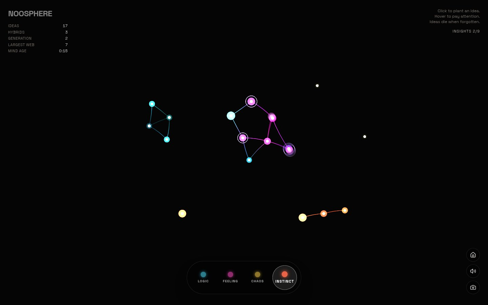
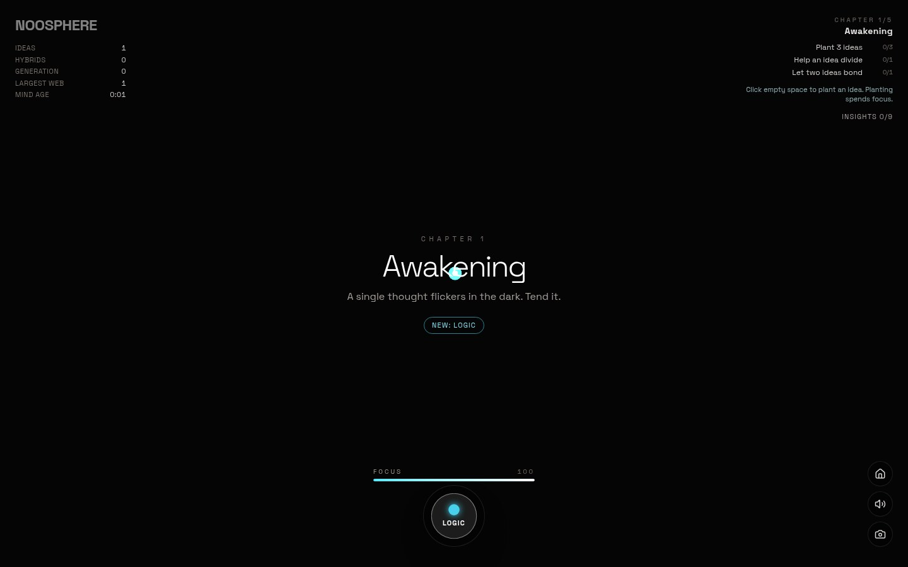
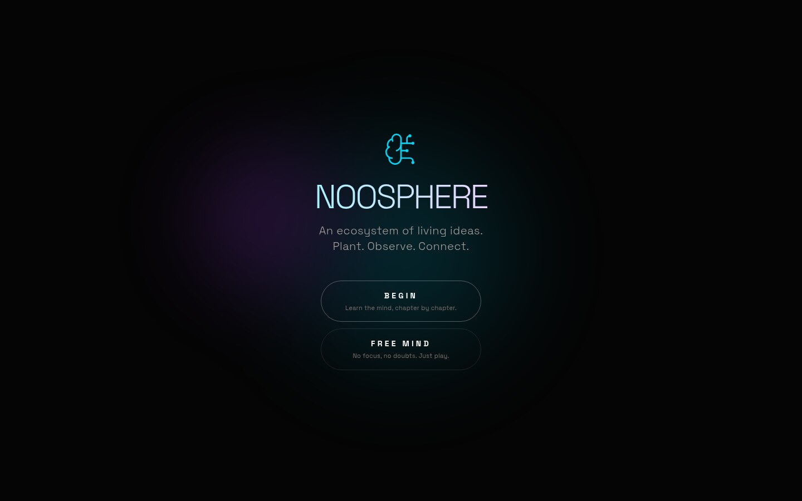

<p align="center">
  
</p>

<h1 align="center">Noosphere</h1>

<p align="center"><strong>An ecosystem of living ideas.</strong></p>

<p align="center">
  <a href="https://gamestudio42.github.io/noosphere/"></a>
  <a href="https://github.com/gamestudio42/noosphere/actions/workflows/pages.yml"></a>
  <a href="https://github.com/gamestudio42/noosphere/stargazers"></a>
  <a href="https://github.com/gamestudio42"></a>
</p>

<p align="center">
  A browser game where thoughts behave like organisms. You plant ideas, pay attention to them and
  watch them bond, split and merge into hybrids — while doubts drift in to drain them and focus,
  your only resource, runs out. No installation is needed to play.
</p>

<p align="center">
  <a href="https://gamestudio42.github.io/noosphere/">
    
  </a>
</p>

<p align="center">
  <a href="https://gamestudio42.github.io/noosphere/">
    
  </a>
</p>

## Watch a mind grow

1. **Plant.** Click empty space to plant an idea of the selected archetype. Planting spends focus,
   and focus is the only thing standing between you and an empty screen.
2. **Pay attention.** Hover an idea (or hold a finger on it) to feed it energy. Attention is what
   keeps it alive; an idea nobody tends to fades and dies.
3. **Spend the focus.** Focus regenerates over time and faster with living hybrids, but planting,
   stimulating and feeding all draw from the same bar. Denied actions shake it.
4. **Let them bond.** Neighbouring ideas grow synapses. When two different archetypes touch, they
   birth a **hybrid** that blends their colour, sound and behaviour — and speeds up regeneration.
5. **Hold the mind together.** Doubts drift in from the edges and drain the ideas they latch onto.
   Logic ideas dissolve them, well-connected webs resist, and clicking a doubt banishes it for
   focus. When every idea dies, the mind is forgotten and you plant a new one.

The simulation runs on a seeded random source, so a mind grows the same way from the same seed. The
mind is saved in the browser, so you can close the tab and come back.

## See the mind

<table>
<tr>
<td align="center" width="50%" valign="top">
<br>
The campaign teaches the game one idea at a time.
</td>
<td align="center" width="50%" valign="top">
<br>
Two ways in: the campaign, or the sandbox with no focus cost.
</td>
</tr>
</table>

### Archetypes

| Archetype | Behaviour                                                          |
| --------- | ------------------------------------------------------------------ |
| Logic     | Fades slowly and builds stable structures; dissolves doubts nearby |
| Feeling   | Bonds easily with everything nearby                                |
| Chaos     | Multiplies fast, burns out fast                                    |
| Instinct  | Heavy and slow, pulls other ideas in                               |

Each pair of archetypes has an affinity that draws them together or pushes them apart (see
`AFFINITY` in `constants.ts`).

## Status

The five-chapter campaign is playable: each chapter unlocks Logic, Chaos, doubts, Feeling and
Instinct in turn, with objectives and hints, and extinction retries the current chapter keeping
finished objectives. Free Mind is the original sandbox: every archetype, no focus cost and no
doubts. Nine insights track milestones in a session; the mind is saved and exported as a PNG
portrait.

Still open in the [roadmap](ROADMAP.md): a WebGL renderer with real bloom, a shape per archetype
that also fixes colour blindness, keyboard play, hero moments for hybrid births, music locked to a
scale, PWA offline support and translations.

What is implemented, how it was verified and what is knowingly missing is in the
[project status](docs/STATUS.md); open work is in [TASKS.md](TASKS.md).

## Play

Open **[gamestudio42.github.io/noosphere](https://gamestudio42.github.io/noosphere/)**. Choose
**BEGIN** to learn the mind chapter by chapter, or **FREE MIND** for the sandbox. The interface is
in English; contextual hints explain each mechanic the first time it matters.

| Action            | How                                             |
| ----------------- | ----------------------------------------------- |
| Choose a mode     | **BEGIN** (campaign) or **FREE MIND** (sandbox) |
| Plant an idea     | click empty space (spends focus)                |
| Feed an idea      | hover it, or hold a finger on it                |
| Stimulate an idea | click it for a burst of energy                  |
| Banish a doubt    | click it                                        |
| Change archetype  | the four archetype buttons on the left          |
| Back to menu      | the home button (the mind is saved)             |
| Mute / unmute     | the speaker button                              |
| Save a portrait   | the image button (PNG of the current mind)      |

There are no keyboard shortcuts yet — that is on the roadmap. The view respects
`prefers-reduced-motion`: no trails, sway or particles when it is set.

## Develop

Requires Node.js 22+.

```sh
npm install
npm run dev        # http://localhost:3000
```

| Command           | Purpose                                                       |
| ----------------- | ------------------------------------------------------------- |
| `npm run check`   | Type check, lint and the Vitest suite (36 tests)              |
| `npm run build`   | Static build in `dist/`, relative paths, runs from any folder |
| `npm run preview` | Serves the built site locally                                 |

The simulation lives in `utils/gameLogic.ts` and is pure apart from the swappable RNG in
`utils/random.ts`. `utils/renderer.ts` draws the canvas and exports the PNG, `utils/audio.ts` plays
the tones and the ambient drone, and `components/Board.tsx` owns the animation loop and input. See
the [roadmap](ROADMAP.md), the [project status](docs/STATUS.md), the [tasks](TASKS.md), the
[asset register](ASSETS.md), the [architecture](docs/architecture/overview.md), the
[decisions](docs/decisions/), the [rules for agents](AGENTS.md) and `.gs42/standards/` for the
engineering standards of this workspace.

Every push to `main` runs type check, lint, tests and build, then publishes `dist/` to the
`gh-pages` branch. Pull requests get a preview under `/pr-preview/pr-<number>/`.

## Licence

Noosphere is free software under the GNU Affero General Public License, version 3 or any later
version ([`AGPL-3.0-or-later`](LICENSE)). Copyright (c) 2026 Marcel Savegnago. If you run a modified
version for other people, including as a website or over a network, you must offer them its source
under the same licence.

Code, procedural art and synthesized sound are original to this project.
